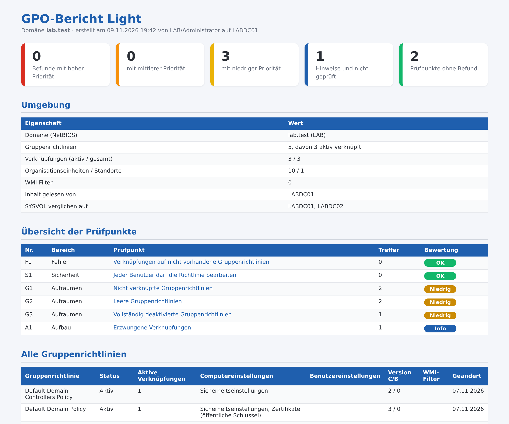

# GPO-Bericht Light – Gruppenrichtlinien prüfen und aufräumen

Kostenloses PowerShell-Skript: prüft Gruppenrichtlinien, ihre Verknüpfungen und den Stand in SYSVOL in **6 Punkten** und erzeugt einen übersichtlichen **HTML-Bericht auf Deutsch**. Es arbeitet **ausschließlich lesend**: Es ändert nichts, legt nichts an und überträgt keine Daten.



Der gezeigte Bericht stammt aus einer Testdomäne. Das vollständige Beispiel liegt als [Beispielbericht.html](Beispielbericht.html) bei.

## Was geprüft wird

| Nr. | Bereich | Prüfpunkt |
|---|---|---|
| F1 | Fehler | Verknüpfungen auf nicht vorhandene Gruppenrichtlinien |
| S1 | Sicherheit | Jeder Benutzer darf die Richtlinie bearbeiten |
| G1 | Aufräumen | Nicht verknüpfte Gruppenrichtlinien |
| G2 | Aufräumen | Leere Gruppenrichtlinien |
| G3 | Aufräumen | Vollständig deaktivierte Gruppenrichtlinien |
| A1 | Aufbau | Erzwungene Verknüpfungen |

Jeder Befund kommt mit Erklärung und Empfehlung.

## Start

```powershell
powershell -ExecutionPolicy Bypass -File .\GPO-Bericht-Light.ps1
```

Alle Optionen zeigt `Get-Help .\GPO-Bericht-Light.ps1 -Detailed`. Voraussetzungen und Rechte stehen im Kopf des Skripts. Getestet mit Windows Server 2019, 2022 und 2025 in Testdomänen (deutsches Windows).

## Vollversion

Die Light-Version enthält 6 von 26 Prüfpunkten (23 %). Die **Vollversion** prüft zusätzlich unter anderem:

- Stand in Verzeichnis und SYSVOL unterschiedlich
- Gruppenrichtlinien ohne lesbaren Ordner in SYSVOL
- Ordner in SYSVOL ohne zugehörige Gruppenrichtlinie
- Deaktivierter Teil enthält Einstellungen
- Niemand darf die Richtlinie anwenden
- Benutzerrichtlinie für Computer nicht lesbar
- Verweis auf fehlenden WMI-Filter
- Nicht-Administratoren dürfen die Richtlinie bearbeiten
- Kennwörter in Gruppenrichtlinien
- Deaktivierte Verknüpfungen
- Verknüpfungen an leeren Organisationseinheiten
- Einstellungen passen nicht zum Inhalt der Organisationseinheit
- Mehrere Gruppenrichtlinien mit demselben Namen
- Nicht verwendete WMI-Filter
- Kennwortrichtlinie an unerwarteter Stelle
- Default Domain Policy enthält weitere Einstellungen
- Organisationseinheiten mit deaktivierter Vererbung
- Gruppenrichtlinien mit WMI-Filter
- Richtlinien mit "Verweigern" bei der Anwendung
- Loopback-Verarbeitung eingeschaltet

➜ **[Vollversion auf Gumroad](https://mueller86.gumroad.com/l/wdosl)** · **[Vollversion auf Etsy](https://www.etsy.com/listing/4593129111)** · **[alle Prüfskripte im Shop](https://www.etsy.com/shop/ITAdminToolsbyMM)**

## Hinweise

- Der Bericht enthält Konto-, Rechner- oder Servernamen – bitte vertraulich behandeln.
- Der Bericht zeigt Auffälligkeiten anhand fester Regeln. Er ersetzt keine Sicherheitsprüfung und erhebt keinen Anspruch auf Vollständigkeit.
- Nutzung auf eigene Verantwortung, siehe [LICENSE](LICENSE).
- Bei der Ausarbeitung wurden KI-Werkzeuge unterstützend eingesetzt; Inhalte und Skript wurden fachlich geprüft und im Testlab getestet.

---

### English

Free, read-only PowerShell script that checks Group Policy objects, their links and SYSVOL state (6 checks, German HTML report with findings and recommendations). No changes are made and no data leaves the machine. Run: `powershell -ExecutionPolicy Bypass -File .\GPO-Bericht-Light.ps1`. The full version with 26 checks: https://mueller86.gumroad.com/l/wdosl
